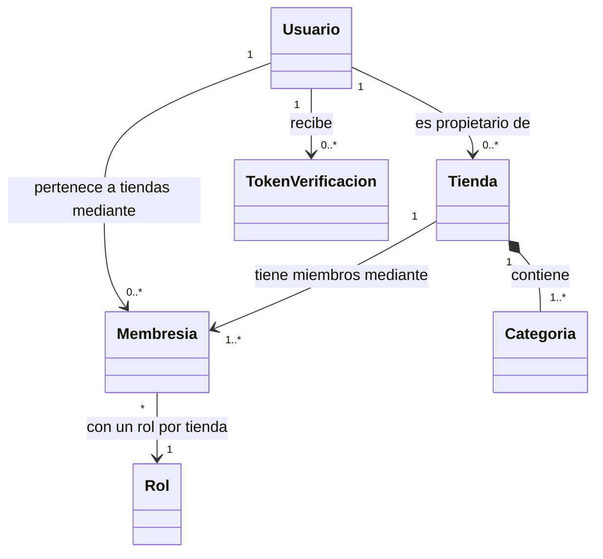
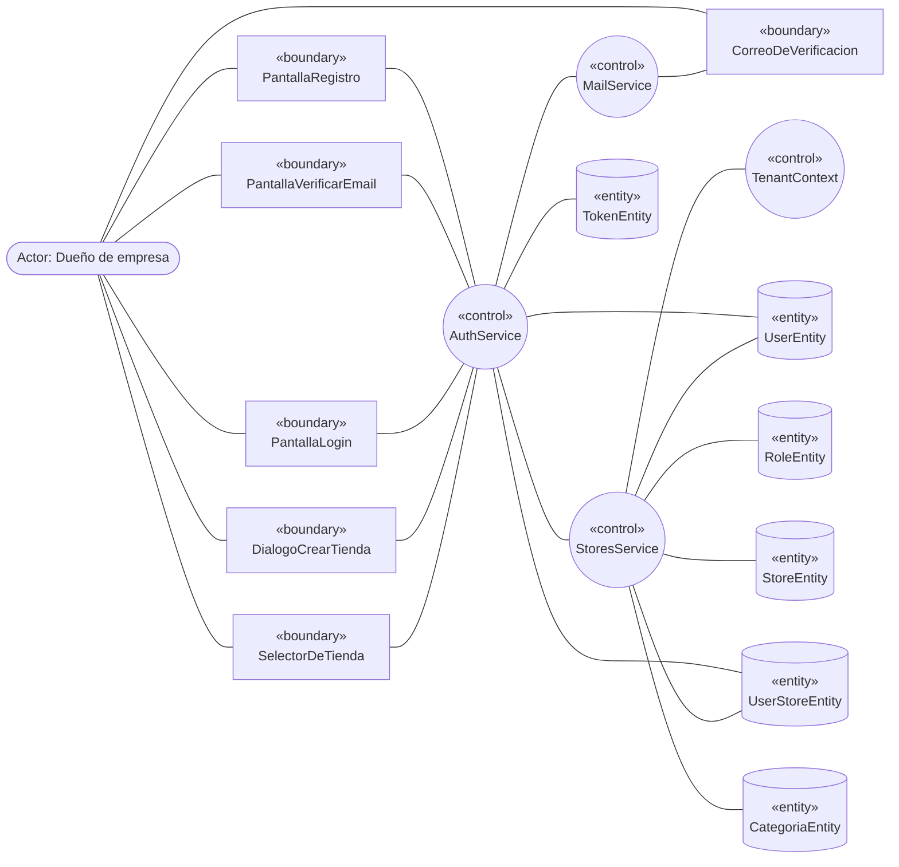
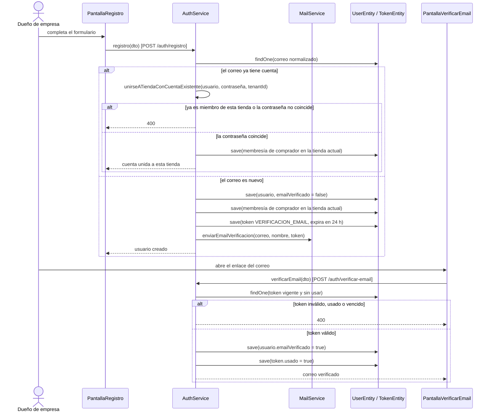
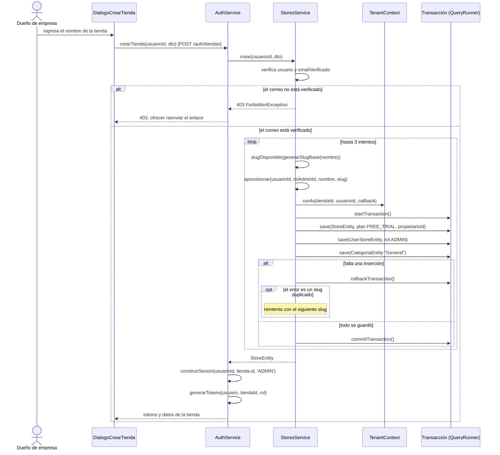
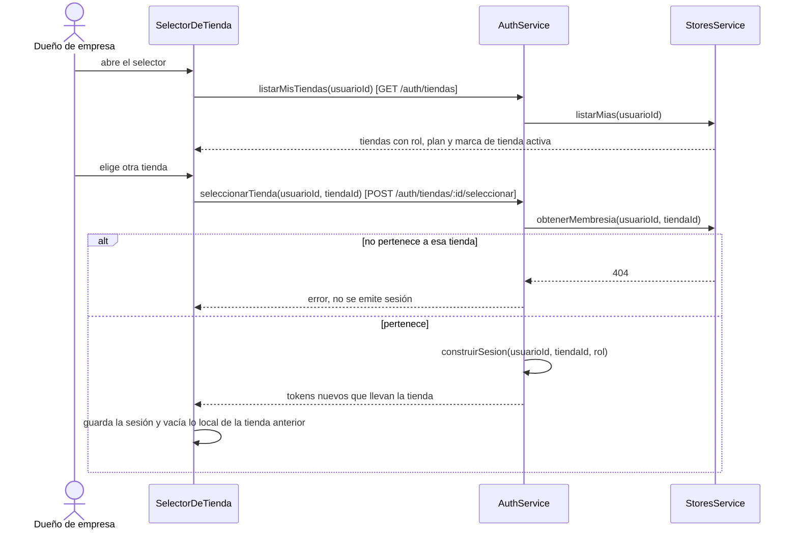
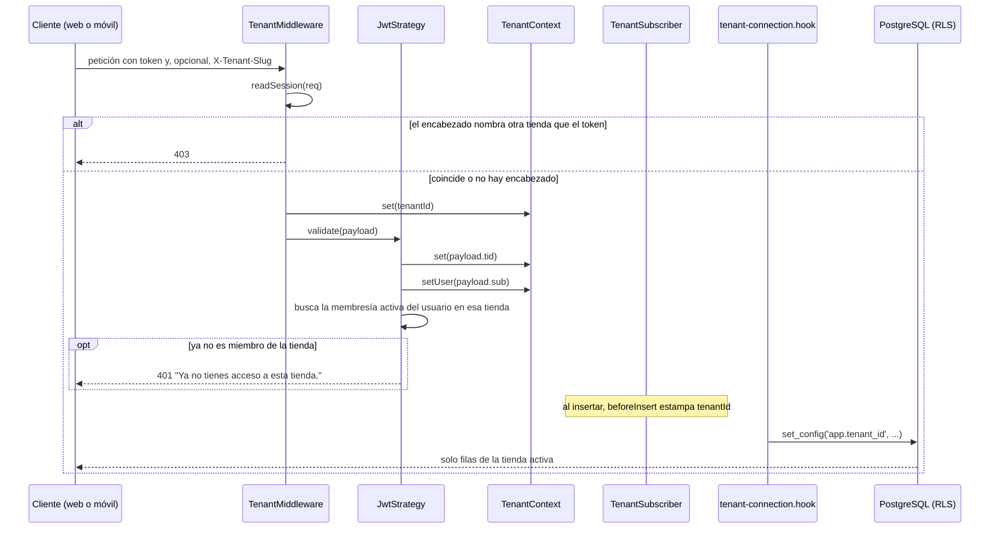
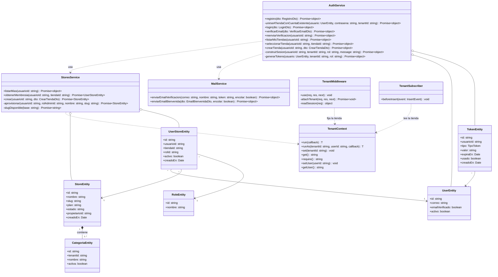

# CU-01: Suscripción y Aprovisionamiento Multi-Tienda

Proyecto AURA, SI2, segundo examen parcial. Metodología ICONIX (UML 2.5+).
Responsable: Diego. Estado del código: implementado y probado (ver la sección 6).

> **Sobre los diagramas.** Están escritos en Mermaid para que se lean directamente en GitHub y se puedan revisar
> junto al código. El plan de trabajo exige entregarlos dibujados en una herramienta CASE (Enterprise Architect,
> StarUML o Visual Paradigm): hay que redibujarlos allí a partir de estos, sin cambiar nombres ni mensajes.
> Todos los nombres de clases y métodos existen en el código (sección 6).

## 1. Ficha del caso de uso

| Campo | Contenido |
|---|---|
| **Código y nombre** | CU-01: Suscripción y Aprovisionamiento Multi-Tienda |
| **Actor principal** | Dueño de empresa (visitante que se convierte en administrador de una tienda) |
| **Actor secundario** | Servicio de correo (Mailtrap) |
| **Objetivo** | Que un cliente se suscriba y obtenga, de forma automática, su propio espacio de trabajo aislado. Con el mismo correo puede tener varias tiendas. |
| **Precondiciones** | La aplicación está desplegada y el rol `ADMIN` existe en el sistema. El visitante dispone de un correo al que puede acceder. |
| **Postcondiciones (éxito)** | Existe una tienda nueva con plan `FREE_TRIAL`; el usuario es su propietario y `ADMIN`; la tienda tiene la categoría inicial "General"; el usuario tiene una sesión activa dentro de la tienda nueva. Ningún dato de otras tiendas es visible desde ella. |
| **Postcondiciones (fallo)** | No queda ninguna tienda a medias: si cualquier paso del aprovisionamiento falla, la transacción se revierte completa. |

### Flujo básico ("Sunny Day")

1. El visitante abre el registro e ingresa nombre, apellido, correo y contraseña.
2. El sistema comprueba si el correo ya tiene cuenta. Si es nuevo, guarda el usuario con el correo sin verificar y
   lo incorpora como comprador a la tienda donde se registró. Si el correo ya tiene cuenta en otra tienda y la
   contraseña coincide, no crea una cuenta nueva: une esa misma cuenta a esta tienda (un correo, varias tiendas).
3. El sistema genera un token de verificación válido por 24 horas y envía el enlace por correo.
4. El visitante abre el enlace de su correo. El sistema marca el correo como verificado y consume el token.
5. El usuario inicia sesión. El sistema comprueba que pertenezca a la tienda en la que entra y le entrega una sesión
   que lleva esa tienda.
6. El usuario elige "Crear una tienda" e ingresa el nombre.
7. El sistema comprueba que el correo esté verificado, genera un identificador corto (slug) único a partir del nombre
   y, en **una sola transacción** y bajo el contexto de la tienda nueva, crea la tienda con plan `FREE_TRIAL`,
   la membresía del usuario como `ADMIN` y la categoría inicial "General".
8. El sistema emite una sesión nueva ya dentro de la tienda creada y el usuario aterriza en su panel de
   administración.
9. Más adelante, con el mismo correo, el usuario puede crear otras tiendas o cambiar de una a otra desde el selector:
   el sistema le entrega una sesión nueva limitada a la tienda elegida.

### Flujos alternos ("Rainy Day")

| # | Situación | Respuesta del sistema |
|---|---|---|
| A1 | En el paso 2, el correo ya es miembro de esta tienda, o ya tiene cuenta y la contraseña no coincide | Responde 400 sin crear ni unir nada ("El correo electrónico ya se encuentra registrado." cuando ya es miembro). |
| A2 | En el paso 3, el correo no llega o el enlace venció | El usuario pide un reenvío: el sistema invalida los enlaces anteriores y genera uno nuevo, con un máximo de uno por minuto. |
| A3 | En el paso 4, el token es inválido, ya se usó o expiró | Responde 400 "El enlace o token de verificación es inválido, ya fue utilizado o ha expirado." |
| A4 | En el paso 5, la contraseña es incorrecta o la cuenta está bloqueada | Responde 401. Con credenciales incorrectas no dice si falló el correo o la contraseña; con una cuenta bloqueada avisa que está inactiva o bloqueada. |
| A5 | En el paso 5, el usuario no pertenece a la tienda | Responde 401 "No tienes acceso a esta tienda." |
| A6 | En el paso 7, el correo no está verificado | Responde 403 "Verifica tu correo electrónico antes de crear una tienda." La interfaz ofrece reenviar el enlace. |
| A7 | En el paso 7, dos suscripciones simultáneas con el mismo nombre eligen el mismo slug | La perdedora reintenta con el siguiente slug disponible, hasta 3 intentos; si no lo logra, responde 409. |
| A8 | En el paso 7, falla cualquier inserción del aprovisionamiento | Se revierte la transacción completa; no queda tienda, membresía ni categoría parciales. |
| A9 | En el paso 9, el usuario intenta entrar a una tienda a la que no pertenece | Responde 404 y no emite sesión. |
| A10 | El token de una tienda se usa con el encabezado `X-Tenant-Slug` de otra | Responde 403 "La tienda indicada no coincide con tu sesión." |

## 2. Modelo de dominio (Hito 1)

Solo conceptos y relaciones, sin métodos.

## 3. Diagrama de robustez (Hito 2)

Reglas de conexión de ICONIX que cumple el diagrama: el actor solo toca objetos Boundary; los Boundary solo se
conectan con Controllers y actores; las Entities solo se conectan con Controllers.

- **Boundary:** `PantallaRegistro`, `PantallaVerificarEmail`, `PantallaLogin`, `DialogoCrearTienda`,
  `SelectorDeTienda`, `CorreoDeVerificacion`.
- **Control:** `AuthService`, `StoresService`, `MailService`, `TenantContext`.
- **Entity:** `UserEntity`, `TokenEntity`, `RoleEntity`, `StoreEntity`, `UserStoreEntity`, `CategoriaEntity`.

## 4. Diagramas de secuencia (Hito 3)

Cada mensaje es un método real. Las llamadas HTTP aparecen entre las boundaries y `AuthService`.

### 4.1 Registro y verificación del correo

### 4.2 Alta de tienda y aprovisionamiento del espacio de trabajo

### 4.3 Cambio de tienda activa (mismo correo, varias tiendas)

### 4.4 Cómo se aísla cada petición posterior

## 5. Diagrama de clases de diseño (Hito 3)

## 6. Trazabilidad con el código y las pruebas

| Elemento del caso de uso | Dónde está | Qué lo prueba |
|---|---|---|
| Registro y token de verificación | `apps/api/src/modules/autenticacion/auth.service.ts` (`registro`, `verificarEmail`, `reenviarVerificacion`) | `test/unit/auth.service.spec.ts` |
| Aprovisionamiento transaccional | `apps/api/src/modules/tiendas/stores.service.ts` (`crear`, `aprovisionar`) | `test/unit/stores.service.spec.ts` |
| Sesión por tienda y cambio de tienda | `auth.service.ts` (`seleccionarTienda`, `construirSesion`), `tiendas.api.ts` en web y móvil | `auth.service.spec.ts` (sesión con tienda y rol, login sin membresía) y `stores.service.spec.ts` (`obtenerMembresia`, `listarMias`) |
| Aislamiento por tienda | `tenant.middleware.ts`, `tenant-context.ts`, `tenant.subscriber.ts`, `database/05_rls.sql` | `test/unit/tenant.middleware.spec.ts`, `test/db/tenant-isolation.spec.ts` |
| Un correo con varias tiendas | tabla `usuario_tienda` (`database/03_multi_tenant.sql`) | `test/db/tenant-isolation.spec.ts` |
| Interfaz web | `apps/web/src/features/tiendas` (`StoreSwitcher`) | Prueba manual |
| Interfaz móvil | `apps/mobile/src/components/StoreSwitcher.tsx` | Verificación de tipos y del contrato con la API; sin pruebas automáticas (el móvil no tiene ejecutor de pruebas) |

Las pruebas de base de datos se ejecutan con `TEST_DB_ADMIN_URL` definido; sin esa variable se omiten.
