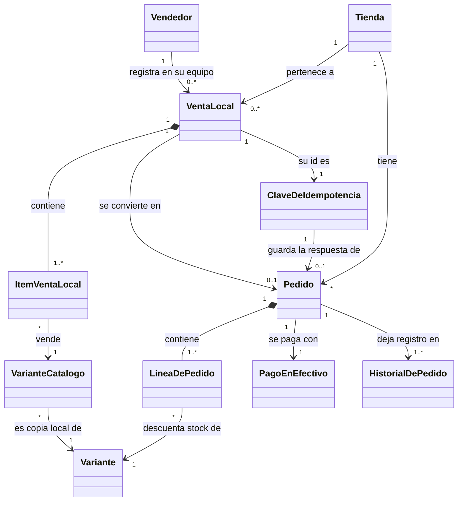
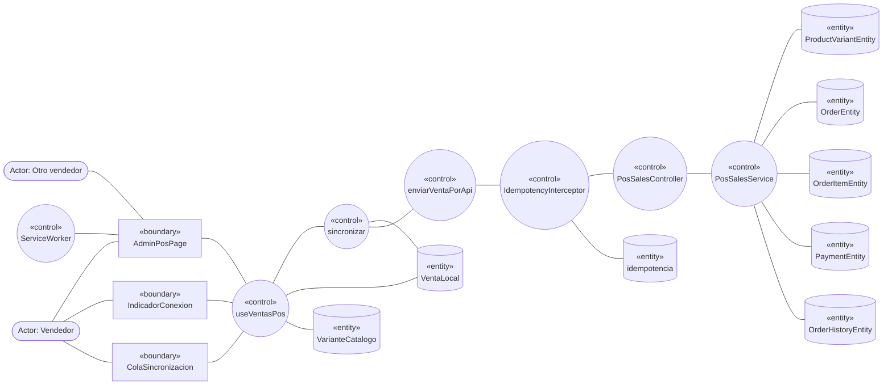
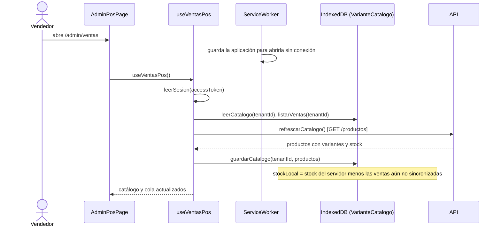
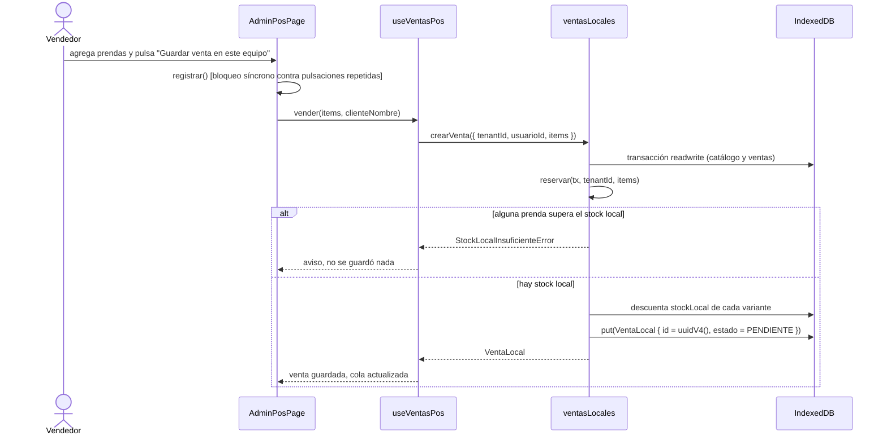
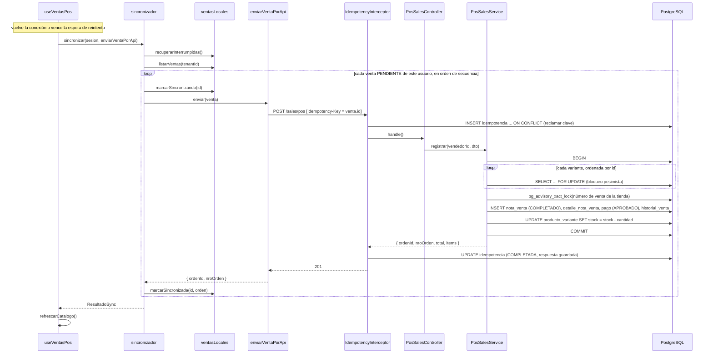
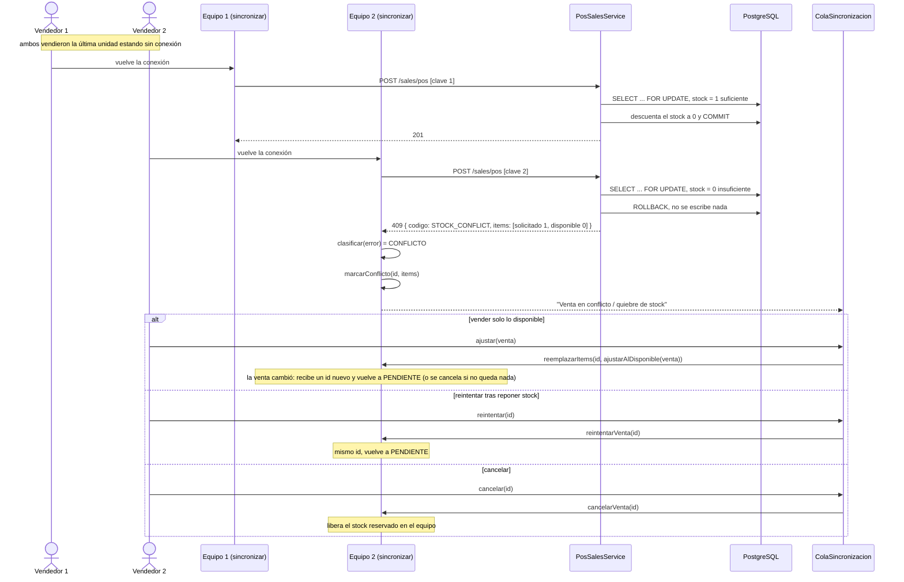
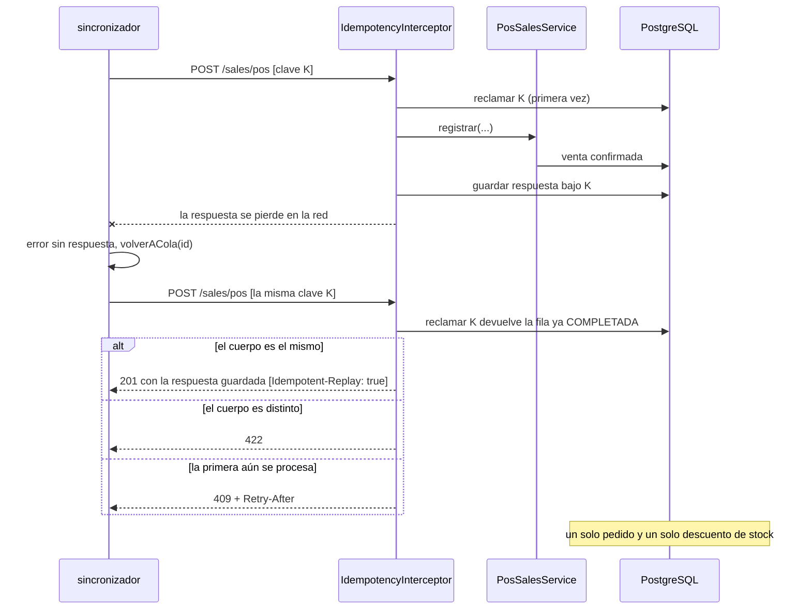
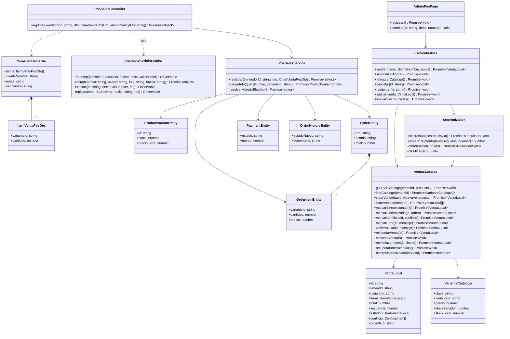
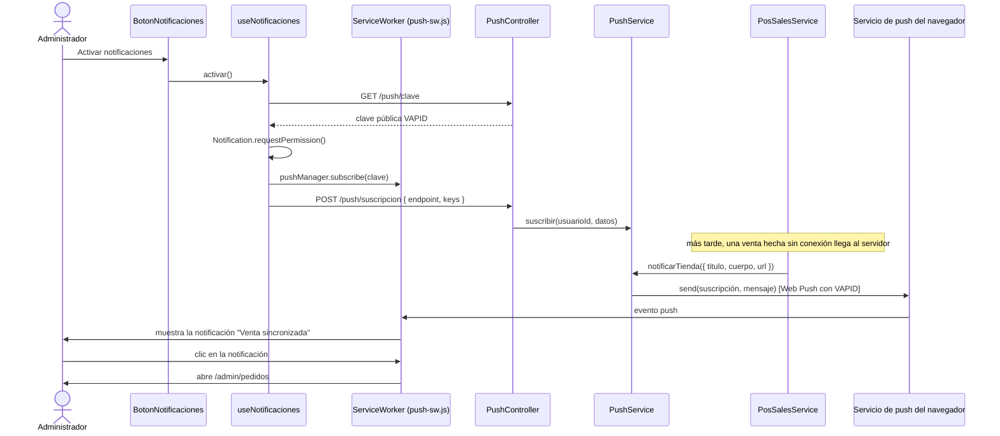

# CU-02: Venta Offline y Sincronización con Resolución de Conflictos

Proyecto AURA, SI2, segundo examen parcial. Metodología ICONIX (UML 2.5+).
Responsable: Diego. Estado del código: implementado y probado en la web y en el servidor; el cliente móvil (SQLite)
todavía no existe (ver la sección 7).

> **Sobre los diagramas.** Están escritos en Mermaid para que se lean directamente en GitHub y se puedan revisar
> junto al código. El plan de trabajo exige entregarlos dibujados en una herramienta CASE (Enterprise Architect,
> StarUML o Visual Paradigm): hay que redibujarlos allí a partir de estos, sin cambiar nombres ni mensajes.
> Todos los nombres de clases y métodos existen en el código (sección 6).

## 1. Ficha del caso de uso

| Campo | Contenido |
|---|---|
| **Código y nombre** | CU-02: Venta Offline y Sincronización con Resolución de Conflictos |
| **Actor principal** | Vendedor (usuario `ADMIN` de una tienda, trabajando en el mostrador) |
| **Actor secundario** | Otro vendedor de la misma tienda, que puede vender las mismas prendas desde otro equipo |
| **Objetivo** | Que el vendedor pueda registrar ventas en efectivo aunque no haya internet, y que al volver la conexión esas ventas se registren en el servidor sin duplicarse y sin vender stock que ya no existe. |
| **Precondiciones** | El vendedor inició sesión en la tienda y abrió el punto de venta al menos una vez con conexión, para que el equipo guarde la aplicación y una copia del catálogo. |
| **Postcondiciones (éxito)** | Cada venta aceptada existe una sola vez en el servidor como pedido `COMPLETADO` con su pago en efectivo `APROBADO`, y su stock está descontado. En el equipo la venta figura como `SINCRONIZADA` con el número de pedido. |
| **Postcondiciones (conflicto)** | Si falta stock no se escribe nada en el servidor (ni pedido, ni pago, ni descuento). La venta queda en el equipo como `CONFLICTO` y el vendedor decide qué hacer. |

### Flujo básico ("Sunny Day")

1. Con conexión, el vendedor abre `/admin/ventas`. El sistema descarga el catálogo y guarda una copia local de cada
   variante (nombre, talla, color, precio vigente y stock). El navegador guarda además la aplicación para poder
   abrirla sin conexión.
2. Se corta la conexión. El indicador pasa a "Sin conexión" y el vendedor sigue trabajando con la copia local.
3. El vendedor busca prendas y las agrega a la venta actual. No puede agregar más unidades que el stock que queda
   en este equipo.
4. El vendedor elige "Guardar venta en este equipo". El sistema genera un identificador UUID v4 para la venta, reserva
   el stock en la copia local y guarda la venta en la cola con estado `PENDIENTE`, todo en una sola transacción local.
5. Vuelve la conexión. El sistema toma las ventas `PENDIENTE` de esta tienda y de este usuario, en el orden en que se
   hicieron, y envía una por una al servidor con el UUID de la venta como cabecera `Idempotency-Key`.
6. El servidor reclama la clave, abre una transacción, bloquea las variantes en orden de identificador, comprueba el
   stock, crea el pedido `COMPLETADO` con sus líneas, el pago en efectivo `APROBADO` y el historial, descuenta el
   stock, confirma la transacción, guarda la respuesta bajo la clave y responde 201.
7. El sistema marca la venta `SINCRONIZADA` con el número de pedido y renueva la copia del catálogo con el stock
   real del servidor.

### Flujos alternos ("Rainy Day")

| # | Situación | Respuesta del sistema |
|---|---|---|
| A1 | En el paso 6, otra venta se llevó parte del stock antes (dos vendedores sin conexión vendieron la última prenda) | El servidor revierte la transacción y responde 409 con `codigo: STOCK_CONFLICT` y, por cada prenda faltante, lo solicitado y lo disponible. La venta pasa a `CONFLICTO` ("Venta en conflicto / quiebre de stock"). El vendedor elige: vender solo lo disponible, reintentar tras reponer stock o cancelar. |
| A2 | En el paso 5, no hay red, el servidor no responde (5xx) o la sesión expiró (401) | La venta vuelve a `PENDIENTE` con el motivo del último intento y la sincronización se detiene para no romper el orden ni saturar. Se reintenta sola con espera creciente (5 s, 10 s, 20 s, 40 s, hasta 60 s). |
| A3 | En el paso 6, el servidor registró la venta pero la respuesta se perdió | La venta sigue `PENDIENTE`. El reintento usa el mismo UUID: el servidor devuelve la respuesta guardada (cabecera `Idempotent-Replay: true`) y no registra otra venta. Aunque el servidor hubiera perdido ese registro, el pedido guarda la clave y la base de datos impide un segundo pedido con ella: se devuelve el que ya existe. |
| A4 | En el paso 4, el vendedor pulsa el botón varias veces seguidas | Un bloqueo síncrono en la pantalla deja pasar solo la primera pulsación: se crea una sola venta. |
| A5 | En el paso 5, la misma clave llega mientras la primera petición aún se procesa | 409 sin código de stock y con `Retry-After`: el cliente la trata como reintentable, no como conflicto. |
| A6 | En el paso 5, la misma clave llega con un cuerpo distinto | 422. La venta pasa a `ERROR` con el mensaje del servidor; el vendedor puede reintentar o cancelar. |
| A7 | En el paso 5, el servidor rechaza la venta por otra razón definitiva (otro 4xx) | La venta pasa a `ERROR` con el mensaje del servidor y la sincronización sigue con la siguiente. |
| A8 | En el paso 4, la cantidad pedida supera el stock local | `StockLocalInsuficienteError`: no se guarda nada y se muestra el aviso. |
| A9 | En el paso 5, la pestaña se cerró en mitad del envío | Al abrir de nuevo, las ventas que quedaron `SINCRONIZANDO` vuelven a `PENDIENTE` y se reenvían con la misma clave; el servidor no las duplica. |
| A10 | Hay ventas guardadas de otra tienda o de otro usuario en el mismo equipo | No se envían: el servidor registraría la venta en la tienda y con el vendedor equivocados. Siguen guardadas hasta que esa sesión vuelva. |
| A11 | La petición llega sin `Idempotency-Key` | 400. Sin la clave, un reintento duplicaría la venta. |
| A12 | El vendedor quiere cobrar con tarjeta o QR sin conexión | No se ofrece: esos cobros exigen comunicación inmediata con la pasarela. La pantalla solo vende en efectivo y lo dice. |
| A13 | El equipo nunca descargó el catálogo | La pantalla explica que debe conectarse una vez para descargarlo. |
| A14 | En el paso 4, la copia local del catálogo tiene más de 7 días (límite configurable) y no hay conexión | `CatalogoVencidoError`: no se guarda la venta y se pide conectarse para renovar la copia. Con conexión, la copia se renueva sola. |
| A15 | Una venta guardada lleva más de 7 días sin enviarse | Se marca "Antigua" en la cola, pero nunca se borra: se envía igual al conectarse. |

## 2. Modelo de dominio (Hito 1)

Solo conceptos y relaciones, sin métodos.

## 3. Diagrama de robustez (Hito 2)

Reglas de conexión de ICONIX que cumple el diagrama: el actor solo toca objetos Boundary; los Boundary solo se
conectan con Controllers y actores; las Entities solo se conectan con Controllers.

- **Boundary:** `AdminPosPage` (catálogo y venta actual), `IndicadorConexion`, `ColaSincronizacion`.
- **Control:** `useVentasPos`, `sincronizar` (sincronizador), `enviarVentaPorApi`, `ServiceWorker`,
  `IdempotencyInterceptor`, `PosSalesController`, `PosSalesService`.
- **Entity:** `VentaLocal`, `VarianteCatalogo` (en IndexedDB); `idempotencia`, `ProductVariantEntity`, `OrderEntity`,
  `OrderItemEntity`, `PaymentEntity`, `OrderHistoryEntity` (en PostgreSQL).

## 4. Diagramas de secuencia (Hito 3)

Cada mensaje es un método real. Las llamadas HTTP aparecen entre el cliente y el servidor.

### 4.1 Preparar el equipo con conexión (catálogo y aplicación)

### 4.2 Registrar una venta sin conexión

### 4.3 Sincronización y registro en el servidor

### 4.4 Conflicto: dos vendedores venden la última prenda

### 4.5 Reintento con la misma clave (respuesta perdida o doble pulsación)

## 5. Diagrama de clases de diseño (Hito 3)

## 6. Trazabilidad con el código y las pruebas

| Elemento del caso de uso | Dónde está | Qué lo prueba |
|---|---|---|
| Registro atómico de la venta, bloqueo en orden de id, 409 por prenda faltante | `apps/api/src/modules/ventas/pos-sales.service.ts` (`registrar`) | `apps/api/test/unit/pos-sales.service.spec.ts` |
| Endpoint, roles y clave obligatoria | `apps/api/src/modules/ventas/pos-sales.controller.ts`, `dto/crear-venta-pos.dto.ts` | `pos-sales.service.spec.ts` (controlador sin clave responde 400) |
| Idempotencia (reclamo, reproducción, 409, 422, liberación al fallar) | `apps/api/src/common/idempotency/idempotency.interceptor.ts`, `database/07_idempotencia.sql` | `apps/api/test/unit/idempotency.interceptor.spec.ts` |
| Cero duplicados garantizado en la base de datos (clave en el pedido, índice único, bloqueo por clave) | `database/08_nota_venta_clave.sql`, `pos-sales.service.ts` (`registrar`, `buscarPorClave`, `resumenDe`) | `pos-sales.service.spec.ts` (clave guardada, bloqueo, pedido existente, violación del índice) y prueba HTTP contra PostgreSQL |
| Límite de tiempo de los datos locales (7 días configurables) | `apps/web/src/features/ventas-pos/services/retencion.ts`, fecha del catálogo en `ventasLocales.ts` (`leerActualizacionCatalogo`) | `__tests__/retencion.test.ts` (7 pruebas) |
| Fotos disponibles sin conexión | `services/imagenes.ts` (`precargarImagenes`), caché `aura-imagenes` del service worker | `__tests__/imagenes.test.ts` (5 pruebas) y prueba en navegador |
| Stock agotado como 409 también en los cobros del carrito | `apps/api/src/modules/pagos/payments.service.ts` | `apps/api/test/unit/payments.stock-conflict.spec.ts` |
| Copia local del catálogo, cola, reserva de stock, estados | `apps/web/src/features/ventas-pos/services/ventasLocales.ts`, `posDb.ts` | `__tests__/ventasLocales.test.ts` (19 pruebas, con `fake-indexeddb`) |
| Sincronización ordenada y clasificación de fallos | `services/sincronizador.ts`, `services/enviarVenta.ts` | `__tests__/sincronizador.test.ts` (13 pruebas) |
| Sesión de tienda y usuario | `services/sesion.ts` | `__tests__/sesion.test.ts` |
| Resolución de conflictos | `services/conflictos.ts`, acciones de `ColaSincronizacion` | `__tests__/conflictos.test.ts` |
| Pantalla, indicador de conexión y cola | `pages/AdminPosPage.tsx`, `components/IndicadorConexion.tsx`, `components/ColaSincronizacion.tsx`, `hooks/useVentasPos.ts` | Prueba de extremo a extremo en navegador (ver abajo) |
| Aplicación disponible sin conexión | `apps/web/vite.config.ts` (`VitePWA`) | Prueba de extremo a extremo en navegador (ver abajo) |

**Prueba de extremo a extremo.** Se ejecutó en Chromium con Playwright, contra una copia de la base de datos y cortando la
red del navegador. Los guiones no están en el repositorio. Comprobó: venta sin conexión y cola con dos ventas; recarga de la
página sin conexión con la cola intacta; sincronización al volver la red (una venta aceptada y otra en conflicto por
falta de stock); reintento tras reponer stock; cuatro pulsaciones seguidas del botón (una sola venta); respuesta perdida y
reintento (un solo pedido). En el servidor, con la misma copia de la base de datos: seis ventas simultáneas por la última
unidad dieron una venta y cinco 409, y ocho ventas simultáneas dieron ocho números de pedido distintos.

Las pruebas de la API se ejecutan con `npx jest` en `apps/api`; las de la web con `pnpm test` en `apps/web`.

## 7. Decisiones, límites y pendientes

- **Resolución de conflictos.** El servidor decide por orden de llegada: la primera venta que llega descuenta el stock y
  la siguiente recibe 409. El plan menciona "control de concurrencia optimista y *vector timestamping*"; el código no
  usa relojes vectoriales. La hora del dispositivo solo se guarda como fecha de la venta (`vendidoEn`, nunca posterior
  a la hora del servidor) y no decide quién gana.
- **Precio.** El servidor cobra siempre el precio vigente (precio del producto más extra de la variante). El precio que el
  vendedor vio sin conexión es solo informativo.
- **Solo efectivo.** Tarjeta y QR no funcionan sin conexión (el plan lo exige: validan con la pasarela en el momento).
- **Vendedor.** Es un usuario `ADMIN`, porque el panel de administración hoy solo admite ese rol.
- **Cliente móvil y notificaciones push.** Se documentan en la sección 8.
- **Persistencia con tiempo limitado.** El docente pidió que los datos locales no sean indefinidos y que el negocio fije el
  plazo (horas o días, normalmente hasta siete). El plazo es `RETENCION_DIAS` (7 por defecto, cambiable con
  `VITE_POS_RETENCION_DIAS`; admite fracciones, por ejemplo 0,5 = 12 horas). La copia del catálogo vencida impide vender
  sin conexión; las ventas guardadas muy antiguas se señalan pero nunca se descartan, porque descartarlas perdería dinero.
- **Cero duplicados.** Lo garantizan tres capas: el bloqueo de doble pulsación en pantalla, el registro de la clave en la
  tabla `idempotencia` y, como última barrera, la clave guardada en el propio pedido con un índice único por tienda. Un
  fallo al guardar la respuesta, una clave huérfana tomada a los 2 minutos o un reintento concurrente devuelven el pedido
  que ya existe en lugar de crear otro.
- **Fotos.** Las fotos principales de los productos se descargan en segundo plano cuando se renueva la copia del
  catálogo, y se muestran sin conexión. Una foto que nunca se cargó con conexión no estará disponible.

## 8. Cliente móvil y notificaciones push

### 8.1 Aplicación móvil (SQLite)

El docente pidió persistencia local en el móvil con SQLite. La aplicación móvil replica el comportamiento del cliente web:

| Elemento | Dónde está |
|---|---|
| Esquema SQLite versionado (`PRAGMA user_version`), cola de ventas, copia del catálogo, fecha de renovación | `apps/mobile/src/services/pos/ventasLocales.ts`, `db.ts`, `dbExpo.ts` |
| Reserva de stock, conflictos, reintentos y orden de creación (misma lógica que la web) | `ventasLocales.ts`, `conflictos.ts` |
| Sincronización ordenada y clasificación de fallos | `sincronizador.ts`, `enviarVenta.ts` (`Idempotency-Key` = id de la venta) |
| Límite de 7 días (`RETENCION_DIAS`) | `retencion.ts` |
| Pantalla, indicador y cola | `apps/mobile/src/screens/ventas/`, `apps/mobile/src/hooks/useVentasPos.ts`; entrada desde el perfil del administrador |

La lógica del repositorio recibe una interfaz mínima de base de datos (`Db`); en la aplicación la implementa `expo-sqlite`
y en las pruebas `node:sqlite`. Pruebas: 61 en `apps/mobile` (`pnpm test`) y `tsc` sin errores.
**Verificación en emulador (Android 37, Pixel 6, APK de depuración con `expo-sqlite` real):** se entró como administrador, se
cortó la red del emulador, se guardaron dos ventas en SQLite (la cola mostró "2 por enviar" y el stock local bajó), y al
volver la red la primera se registró en el servidor (pedido NV-2026-00008) y la segunda quedó como "Venta en conflicto /
quiebre de stock" porque otro vendedor había tomado el stock. Tras reponer stock, "Reintentar" la registró (NV-2026-00009)
y el servidor descontó el stock una sola vez. La cola sobrevivió a cerrar y reabrir la aplicación. **Sin comprobar en el
emulador:** el límite de 7 días (solo con pruebas automáticas), un teléfono físico y el flujo de compilación estándar
(`expo run:android`); la prueba usó un APK de depuración con el JavaScript incrustado a mano, por lo que los íconos
vectoriales no se vieron.

### 8.2 Notificaciones push (PWA)

El docente pidió aprovechar las notificaciones de las aplicaciones web progresivas. Cuando una venta hecha sin conexión
llega al servidor, se avisa a los navegadores suscritos de la tienda.

| Elemento | Dónde está | Qué lo prueba |
|---|---|---|
| Suscripciones por tienda (RLS) | `database/09_push_suscripciones.sql`, `push-subscription.entity.ts` | `push.service.spec.ts` |
| Envío con VAPID, baja de suscripciones vencidas (404/410) | `apps/api/src/modules/notificaciones/` (`PushService`, `WebPushSender`) | `push.service.spec.ts` (8 pruebas) |
| Aviso al registrarse una venta hecha sin conexión (más de 60 s de antigüedad) | `pos-sales.service.ts` (`registrar`) | `pos-sales.service.spec.ts` |
| Botón, permiso y suscripción | `apps/web/src/features/ventas-pos/components/BotonNotificaciones.tsx`, `hooks/useNotificaciones.ts` | `__tests__/notificaciones.test.ts` y prueba en navegador |
| Manejo del evento `push` y del clic | `apps/web/public/push-sw.js` (cargado por el service worker generado) | Prueba en navegador |

Se verificó en Chromium (perfil persistente, no incógnito, porque el modo incógnito no admite la API Push): el botón
suscribe, el servidor guarda la suscripción, la notificación de prueba se muestra y, tras sincronizar una venta hecha
sin conexión, aparece "Venta sincronizada". Requiere `VAPID_PUBLIC_KEY` y `VAPID_PRIVATE_KEY` en el servidor
(`npx web-push generate-vapid-keys`); sin ellas el botón avisa que falta configurar. Web Push exige HTTPS en producción
(en `localhost` funciona sin HTTPS).
